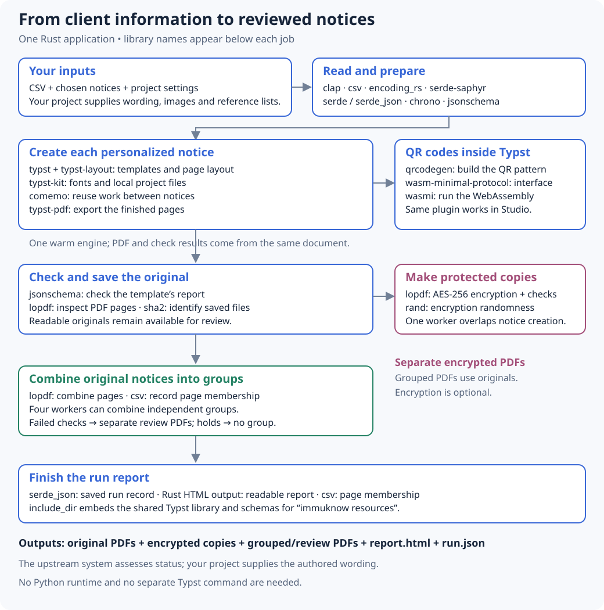

# ImmuKnow

ImmuKnow turns a CSV of immunization information into personalized PDF notices. You choose the notice for each person, or one notice for everyone. The system that supplies the CSV is responsible for assessing immunization status; ImmuKnow does not make that assessment. Review the notice wording and PDFs before sending them.

**1,000 custom notices in about 60 seconds.** Including protected copies, grouped PDFs and a readable report.

[](docs/user_guide/performance.md)

[Explore the interactive timing breakdown](docs/user_guide/performance.md) · [See the libraries in the pipeline](docs/developer_guide/architecture.md#libraries-in-the-pipeline)

<details>
<summary>Libraries from CSV to PDFs</summary>



[Read how the application works](docs/developer_guide/architecture.md).

</details>

## For operators

You need the `immuknow` executable, a CSV, and a configured notice project with templates and settings. Ask your project maintainer for a prepared executable, or see the build instructions below. [ImmuKnow Template](https://github.com/WDGPH/ImmuKnow-Template) provides example notices and settings to adapt and review. Check that your project is set up for this standalone version; see [getting started](docs/user_guide/getting_started.md) and the [template guide](docs/developer_guide/templates.md).

For example, to use one notice for everyone, open a terminal and run the following, replacing the paths with your own:

```sh
immuknow run clients.csv --project project --template overdue_diseases_v1.en.typ
```

Open `report.html` in the new run folder and review its findings and the notices. If grouping is enabled in your settings, the run also contains PDFs combining notices for sending and separate `review-*.pdf` files for readable notices that failed checks. Each grouped PDF has a CSV showing which pages belong to each input row. Warnings are eligible for sending by default, so inspect them too. The [PDF review guide](docs/user_guide/pdf_validation.md) explains the results and how to hold a notice or make a new set of grouped PDFs.

The [getting started guide](docs/user_guide/getting_started.md) walks through the inputs, commands, and results. See also [CSV fields](docs/user_guide/input_schema.md) and [configuration](docs/user_guide/configuration.md).

## See it run


Progress shows the current job and processing speed; the final summary lists the PDFs and findings. This short recording uses the six fictional clients from ImmuKnow Template; the time budget above describes the separate 1,000-notice benchmark. [Recording instructions and VHS tape](docs/developer_guide/documentation.md#recording-the-cli-demo).

## For developers and template authors

To build the executable from this checkout, install Rust 1.92 or later and run:

```sh
cargo install --path . --locked
```

The executable includes the Typst engine and shared resources and uses fonts installed on the workstation. `immuknow resources --output ./immuknow-resources` exports the shared library, schemas, and resource manifest. `immuknow prepare` produces prepared data without PDFs; `immuknow rebundle` makes another set of grouped PDFs from a saved run. See the [template guide](docs/developer_guide/templates.md), [command reference](docs/developer_guide/cli.md), and [contributing guide](docs/developer_guide/contributing.md).
