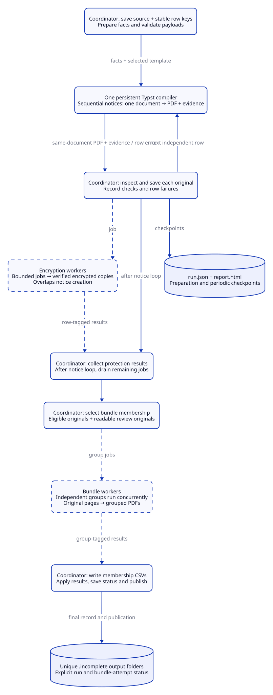

# How the application works

Core follows one main path in `src/pipeline.rs`. It saves the supplied CSV, prepares
one set of client information per row, creates the selected notices with Typst,
checks their reports, makes requested encrypted copies, groups PDFs, and writes
the final report. The system supplying the CSV assesses immunization status;
the selected templates control wording and appearance.

| File | Responsibility |
| --- | --- |
| `src/pipeline.rs` | Coordinate processing, row accounting and saved-run changes. |
| `src/pool.rs` | Bound worker jobs and return results to their caller. |
| `src/main.rs` | Read command options and resolve project folders. |
| `src/terminal.rs` | Show progress and a readable completion summary. |
| `src/input.rs` | Read the CSV, project settings and reference lists; prepare client information. |
| `src/compiler.rs` | Keep each Typst compiler warm and obtain the PDF and checks from the same document. |
| `src/validation.rs`, `src/policy.rs` | Check the report and apply permitted rule changes. |
| `src/pdf.rs` | Encrypt copies and combine PDF pages. |
| `src/bundles.rs` | Choose which notices go into each grouped PDF and matching CSV. |
| `src/report.rs` | Write `run.json` and its readable HTML view. |
| `src/resources.rs` | Export the schemas and Typst library included in the executable. |

## Processing and concurrency

[Open diagram at full size](../assets/processing.svg).

Solid arrows show processing and persistence; dashed arrows carry worker jobs and returned results. Encryption and bundle workers write artifacts and return outcomes to the coordinator, which alone updates the run record. Compilation workers return PDF bytes and evidence for the coordinator to validate evidence and save.

The centre column follows the coordinator; compiler calls, worker jobs and saved outputs sit alongside it. The libraries below are the main direct dependencies, not an exhaustive dependency list. Exact versions are in `Cargo.lock` and `typst-plugins/qr/Cargo.lock`. For ownership and contracts across projects, see [the ecosystem guide](../ecosystem.md).

`clap` reads command options. `csv` and `encoding_rs` read source text; `serde-saphyr` reads YAML settings. `serde`, `serde_json` and `chrono` support structured information and dates, while `jsonschema` checks the prepared data and template reports.

The official `typst`, `typst-layout`, `typst-kit` and `typst-pdf` libraries handle templates, fonts, page layout and PDF export inside the application. `comemo` lets Typst reuse earlier work. Each compiler stays warm across notices. Typst runs the QR WebAssembly plugin through `wasmi`; that plugin uses `qrcodegen` and `wasm-minimal-protocol`. QR encoding currently happens inside that plugin, rather than through a separate native encoder. The same plugin can be used in Studio; see [QR codes](qr.md).

`lopdf` parses saved originals when creating protected copies or combining original pages. `rand` supplies encryption randomness and `sha2` fingerprints saved files. Bounded queues built with Rust's standard library overlap compilation, coordinator work and encryption. On four or more available CPUs, compilation and encryption each default to two workers; smaller machines use one of each. Four workers can combine independent groups afterward. `lopdf`’s optional Rayon parsing is disabled so PDF parsing stays on its calling coordinator or worker; its other default feature, `chrono-clock`, remains enabled. Other libraries may use threads internally too. Grouped PDFs are built from originals, not the encrypted copies.

`serde_json`, Rust's HTML formatting and `csv` write the saved record, readable report and page lists. `include_dir` embeds the shared Typst library and schemas so an installed executable can export them. `anyhow`, `tempfile` and diagnostic helpers support errors and temporary files; they do not form extra pipeline stages.

For the elapsed-time picture, see [the benchmark](../user_guide/performance.md). Overlapping worker times must not be added to the main workflow total.

## Reading the Rust workflow

`Cargo.toml` declares the package and dependencies; `Cargo.lock` pins the resolved dependency graph. `src/main.rs` is the CLI entry point, while `src/lib.rs` exposes the workflow modules in the table above. The QR plugin at `typst-plugins/qr/` is a separate Rust crate with its own manifest and lockfile. Clap derives command parsing, Serde serializes and deserializes structured data, and `anyhow::Result` adds context to operational errors.

Rust’s [ownership and borrowing](https://doc.rust-lang.org/book/ch04-00-understanding-ownership.html) rules make the coordinator’s mutable access explicit; [traits](https://doc.rust-lang.org/book/ch10-02-traits.html) describe shared behavior and bounds such as `Send` and `Sync`. The worker pool uses [scoped threads](https://doc.rust-lang.org/std/thread/fn.scope.html), channels and a mutex around the shared job receiver. Workers release that mutex before processing, so independent jobs can run concurrently. See the Rust book’s [concurrency chapter](https://doc.rust-lang.org/book/ch16-00-concurrency.html) for channels and synchronization.

`run_with_progress` is the coordinator; `run` supplies a no-op progress callback for library callers. The coordinator owns the mutable run record. Each compilation worker owns a persistent compiler and shares the font store. A fixed window of twice the compiler count bounds all queued, active and completed-but-uncommitted notices. The coordinator buffers out-of-order results and advances this window only after committing the next source row. It writes facts and originals, validates evidence, derives passwords and submits encryption jobs. Worker closures return results tagged with their row or group; they do not write the record. Compiler errors remain independent row failures; worker panics wake a waiting coordinator and fail the run after already-submitted encryption is collected. `Result` propagates errors that prevent the workflow from continuing, while expected notice and protection failures are recorded against their rows. Keeping decisions in one sequence makes row accounting and failure recovery traceable: workers cannot race to overwrite policy or bundle membership. The bounded job queue provides backpressure when protection cannot keep up with compilation; the encryption result channel is unbounded and drained between notices.

Embedding the official compiler keeps compilation, PDF export and evidence access inside the same process and document. Each warm compiler reuses fonts and memoized layout work across notices. A worker uses its compiler sequentially and resets its file cache for each row so virtual input and project files cannot retain a previous row’s content. Two workers share Typst’s thread-safe memoization; the coordinator evicts aged entries every five committed rows with a maximum generation age of two. One worker retains per-row eviction with a maximum age of ten. This keeps roughly ten rows of cache history while amortizing shared-cache scans; memory use also depends on template complexity. PDF export and evidence extraction use the same compiled document. Evidence extraction can fail independently, allowing a readable original to be retained for review.

## Keep each client connected to the right notice

Every readable source row receives a key such as `row-000001`, in input order.
That key connects the source values, selected template, prepared information,
checks and PDFs. Filenames use these keys rather than personal identifiers.
A compilation, PDF export or password failure on one row does not stop later independent rows. Payload validation happens before rendering; setup, filesystem, checkpoint and worker errors can stop the run. The source rows are recorded before configuration and preparation, so a partial record accounts for rows successfully read before those later failures.

The compiler reads only the supplied project and local dependencies. Package
imports and downloads are unsupported. The project must contain an unchanged
copy of the shared library exported by this executable. Projects provide their
own settings, reference lists, templates, translations and images.

Input preparation preserves the source text while normalizing names, dates,
histories and reference matches into schema-checked notice facts. The selected
template, language and row identity accompany those facts. `src/compiler.rs`
serializes the notice as virtual JSON, exposed through `sys.inputs.at("data")`;
project setup reads it into the shared Typst components. Components return
structured findings through placed metadata, rather than Core inferring content
from extracted PDF text. The [template guide](templates.md) owns the field and
component contracts.

Typst returns PDF data and invisible check metadata from the same compiled
document. Core checks the metadata against `schemas/rendering.json`,
`typst/report.json`, the selected client and the document's page count. The JSON
is saved separately; it is never attached to the PDF or printed as extra pages.
See [native handoff contracts](../ecosystem.md#native-handoff) for schema versions and resource identity.

## Keep useful results when something fails

Warnings allow inclusion in the normal grouped PDFs by default. A readable
original with failed checks goes into a separate review PDF. A missing or
uncreated original stays in the report only. A notice on hold is excluded from
both sets. Each included original appears once per bundle attempt, with its
page range in the matching CSV. A required page count never adds blank pages.

Encryption creates a separate AES-256 revision 6 PDF using the pinned `lopdf` implementation. Core requires a nonempty password, rejects passwords that become empty under the library’s R6 Unicode preparation, checks the resulting in-memory encryption dictionary and unchanged page count, and propagates encryption, write, flush and rename errors. It does not reopen each output to repeat password authentication. Release tests check empty and wrong password refusal, correct password access, encryption settings and preserved content. Bundle assembly checks its page count before writing; release tests reopen representative bundles. This boundary trusts the library and successful I/O rather than detecting storage corruption by reparsing every new artifact. The original remains available. Derived passwords are
never saved. Compilation and encryption each default to two workers on four or more available CPUs, otherwise one. Up to four bundle workers are used by default.
`src/pool.rs` provides the small bounded work queue. The coordinator alone updates
the saved record and sends count-only progress receipts to the terminal display. Library callers can run without terminal output. The display adds no worker thread. Setting encryption workers to zero runs protection inline; submitted jobs are drained even if a later rendering or checkpoint step fails. Bundling works on a copy of the entries and publishes its staging directory before replacing bundle decisions in memory.

## Save runs and later changes

A new run or bundle set starts in a uniquely named folder ending in `.incomplete`.
A run that reaches final reporting receives its final name even when individual notices failed (`completed_with_failures`). A fatal processing failure retains its `.incomplete` directory and a partial record when reporting succeeds. The coordinator checkpoints after preparation and every 100 notices. `run.json` is the saved record and
`report.html` is its escaped HTML view. These files and PDFs contain personal
information and should be kept private.

`immuknow rebundle` uses the saved originals and checks without creating notices
or repeating encryption. It takes the operating-system `.run.lock` before
reading the record and holds it through writes. When grouping is enabled, each assembly attempt creates a new
numbered folder, leaving earlier bundles available. A bundle assembly failure records a failed attempt and retains the previous bundle decisions; validation errors before assembly return without creating that attempt. Original checks remain in `checks`; permitted rule
changes produce `effective_checks`, with reasons. No visual or page-by-page
comparison is repeated. See [PDF review](../user_guide/pdf_validation.md) for the
commands and [configuration](../user_guide/configuration.md) for grouping rules.
