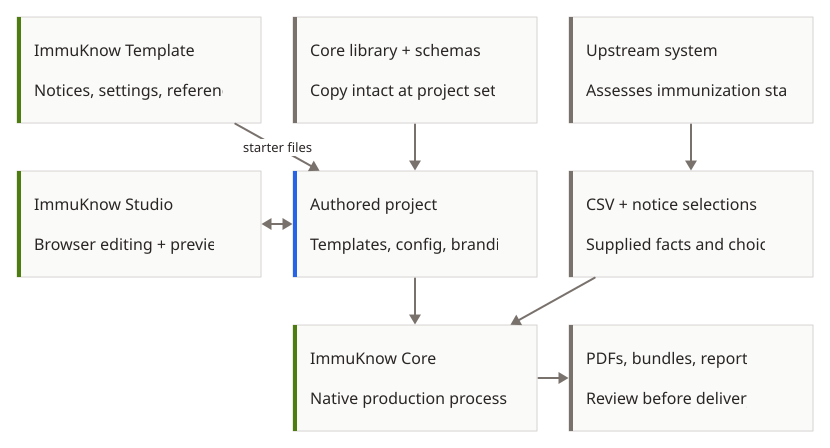

# ImmuKnow projects and contracts

ImmuKnow Core, Template and Studio have separate responsibilities. Core is the
standalone application that prepares supplied client facts, renders notices and
records findings. Template is a starting project that an organization adapts.
Studio is a browser workspace for editing notices and previewing fictional
clients. The system supplying the data assesses immunization status; the
organization chooses and reviews notices before sending them.

[Open diagram at full size](assets/ecosystem.svg).

| Stage | Owner | Files and responsibility |
| --- | --- | --- |
| Build and integration | Core | The executable embeds Typst and exports its shared Typst library, input and rendering schemas, and resource manifest. The manifest identifies each embedded file by SHA-256 and identifies the ordered file list by a digest. |
| Build and integration | Template | The resource package supplies starter project files and fictional clients to Studio. Its recorded Core revision identifies the executable reviewed with that project. |
| Build and integration | Studio | Studio pins its dependencies and browser compiler separately, prepares fictional preview data and browser assets, and tests the browser and project handoff. |
| Authored project | Template and project maintainers | Notices, Settings, translations, branding, configuration and reference lists belong to the project. The shared Core library is copied intact into `templates/lib/immuknow/`; it is not edited there. |
| Authoring | Studio | The browser editor manages previews, drafts, imports and downloads. Authored project files and relative paths must survive the handoff. |
| Runtime | Core and the project | The native executable reads a CSV, explicit notice choices, project configuration and templates. It prepares facts, creates notices, records checks and assembles bundles. Workstation fonts are used for native rendering. |

See the [getting started guide](user_guide/getting_started.md) for a native
project and [Studio](user_guide/studio.md) for the current integration status.
Template's [native starter instructions](https://github.com/WDGPH/ImmuKnow-Template/blob/782d8d4543519b6459ad1c1cfb1e0cbcae537581/README.md)
describe its setup and project files. Each project is updated independently;
updating Core does not update Studio's pins or a project's reference lists.

Studio has **not yet adopted standalone Rust Core**. The diagram shows ownership
and file handoffs, not a claim that current Studio exports work with this
executable. See [Studio compatibility](user_guide/studio.md#compatibility-with-standalone-core)
before exchanging projects.

## Native handoff

`immuknow resources --output DIR` exports `schemas/input_schema.json`,
`schemas/rendering.json`, the `typst/` library including `typst/report.json`,
and `resource-manifest.json`. Export into a new directory when updating and
copy the entire library into the project. Existing identical files are accepted;
different files are not overwritten. The manifest identifies resources, not a
source commit. An executable's version alone does not establish its source
revision.

`immuknow prepare` writes JSON to standard output without creating PDFs. Its
version 1 envelope identifies the engine, resources and input hash and contains
one entry per source row with its `row_key`, `client_id`, source, assignment,
notice and checks. The row key preserves source-row identity even where an
external client ID is absent. Notice facts use schema version 1; rendering
reports use version 2. The unversioned schema filenames identify the current
contracts; the data's `schema_version` identifies its format. Render evidence
is checked against the prepared notice and its identity. See the
[command and facts reference](developer_guide/cli.md) for options and the
[template guide](developer_guide/templates.md) for authoring details.

## Testing the handoffs

Core owns native input, rendering evidence, PDF validation, reporting and bundle
behavior. Template tests its setup, helpers, resource package and one fictional
native sample journey, including starter presentation. Studio tests browser
previews, drafts, import and export, and the downloaded project's journey through
its pinned compatible engine. Adoption of this standalone Core needs the
separate [Studio integration checks](user_guide/studio.md). Each project tests its own boundary rather than
repeating another project's complete validation suite. See Core's
[testing guide](developer_guide/testing.md), Template's
[contributor guide](https://github.com/WDGPH/ImmuKnow-Template/blob/782d8d4543519b6459ad1c1cfb1e0cbcae537581/CONTRIBUTING.md),
and Studio's [development guide](https://github.com/WDGPH/ImmuKnow-Studio/blob/main/docs/development.md).
