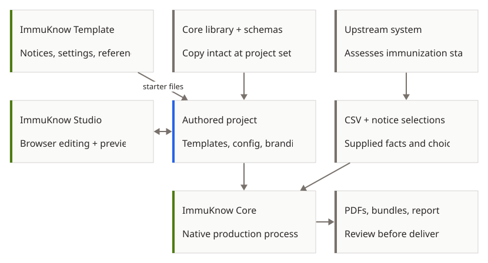

# ImmuKnow

ImmuKnow turns a CSV file of immunization information into personalized PDF
notices. You select the notices; the system that supplied the information is
responsible for assessing immunization status.

## Three projects, one notice workflow

Core owns native processing and shared components. Template supplies the project
that your organization adapts. Studio provides browser editing and previews;
it has not yet adopted standalone Rust Core. Check
[Studio compatibility](user_guide/studio.md) before using an exported project.

[Open diagram at full size](assets/ecosystem.svg).

Read [projects and contracts](ecosystem.md) for ownership, file handoffs and
compatibility. No direct runtime service connects these applications.

## Create and review notices

Start with [getting started](user_guide/getting_started.md). It explains what you
need, how to create notices, and where to find the PDFs and report. The
[configuration guide](user_guide/configuration.md) explains settings and reference
lists. See [CSV fields](user_guide/input_schema.md) for the required columns and
[PDF review](user_guide/pdf_validation.md) for warnings, failed checks and holds.

## Edit templates or work on the application

The [template guide](developer_guide/templates.md) explains how to change notice
content and shared components. Developers can use the
[command reference](developer_guide/cli.md), [architecture guide](developer_guide/architecture.md)
and [contributing guide](developer_guide/contributing.md).

[Studio](user_guide/studio.md) is a separate browser editor. ImmuKnow Template
supplies a starting project. Check their instructions when updating Core.
