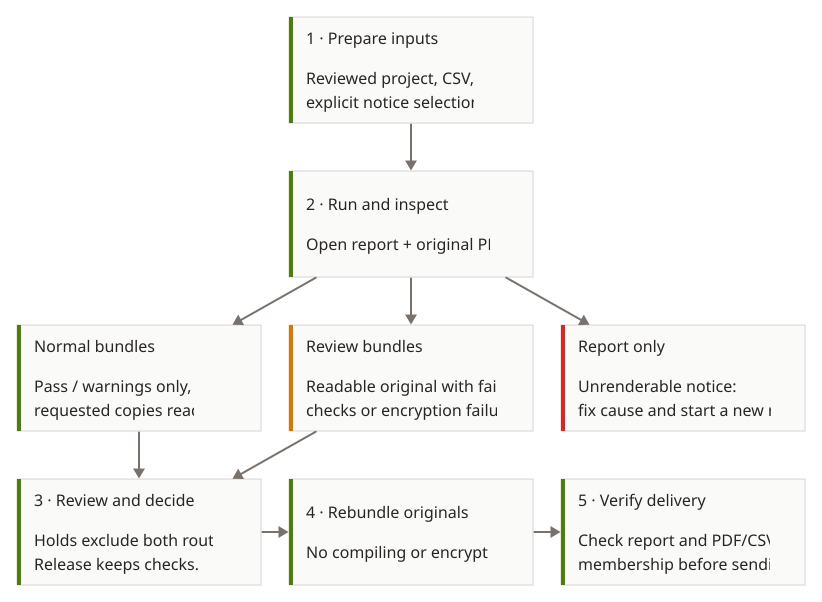

# Getting started

ImmuKnow creates personalized PDF notices from a CSV file and the notice templates you choose. Your source system assesses immunization status; ImmuKnow uses the information and notice choices you provide. Review your notice wording and output before sending it.

## Before you start

You need:

- The `immuknow` executable available in your terminal. Download and extract the matching archive from [Releases](https://github.com/WDGPH/ImmuKnow/releases), or ask your project maintainer for a prepared executable. Choose Windows x64, Linux x64, Apple silicon macOS or Intel macOS; see [platform details](../developer_guide/releases.md#platforms). A developer can build it from the checkout using the instructions in the [contributing guide](../developer_guide/contributing.md#build-the-executable).
- A CSV containing the people and information for the notices. See the [CSV field reference](input_schema.md).
- A configured notice project containing a `templates` folder and a `config` folder. [ImmuKnow Template](https://github.com/WDGPH/ImmuKnow-Template) provides example notices and settings to adapt. Review the wording, branding, contacts, and settings for your organization. Follow [Template’s setup instructions](https://github.com/WDGPH/ImmuKnow-Template/blob/main/README.md) for the matching executable. The project must use resources compatible with your Core executable; see the [template guide](../developer_guide/templates.md). Install the fonts required by your project on the workstation.

Keep input files and run folders in approved storage with access restricted to
people who need them. Saved facts, original and encrypted PDFs, reports and CSV
exports may contain personal information. Encryption creates an additional copy;
it does not protect the remaining artifacts. Apply your organization's transfer,
backup and retention rules to the whole run.

## Workflow at a glance

<div class="architecture-diagram" markdown="1" tabindex="0" role="region" aria-label="Operator workflow diagram">

[](../assets/operator-journey.svg)

</div>

[Open diagram at full size](../assets/operator-journey.svg).

Warnings are eligible for normal delivery by default. Readable originals with
failed checks or failed requested encryption go to review bundles; notices without a readable original remain
in the report. Withheld rows enter neither set. Releasing a hold keeps checks in
force. Grouping must be enabled to produce bundles.

## Set up and check a project

From a configured Template or Studio project folder, install the shared library
and check the fictional sample:

```sh
immuknow project sync
immuknow project check --sample
immuknow run --sample
```

The check removes its temporary output; the run keeps notices and a report under
`runs/`. Setup and sample commands require no Python or uv. A project without
fictional inputs can still run your own CSV and notice selection below.
Use `--project /path/to/project` when running from another folder. See the
[command reference](../developer_guide/cli.md#native-project-setup-and-samples)
for sample paths and refreshing the complete shared library after a Core update.

## Create notices

Open a terminal. To use one notice for everyone in the CSV, run this command, replacing the paths with your own:

```sh
immuknow run clients.csv --project project --template overdue_diseases.en.typ
```

Here `clients.csv` is your input file, `--project` points to the folder containing `templates/` and `config/`, and `--template` names the notice to use from that project. Results go into `runs/` unless you choose another folder with `--output`.

To choose a notice separately for each person, supply a selection file and the folder containing the notices instead of `--template`:

```sh
immuknow run clients.csv --project project --notices notices.json
```

If your terminal is already open in the project folder, you can omit `--project project`: `immuknow run clients.csv --notices notices.json` uses the local `templates/` and `config/` folders.

`--notices` is a shorter name for `--notice-assignments`; both take the same JSON selection file. CSV and selection-file paths are relative to your current folder. With `--project`, a relative `--template` is looked up inside that project's `templates/` folder. `--config` overrides the project configuration folder. With an assignment file, `--templates` overrides its templates folder; it cannot be combined with `--template`.

## Follow the progress

The terminal shows the current job, a progress bar while notices are processed, a running count of protected copies, and processing speed once work has been running for a second. It then summarizes source-row severity, delivery and finding codes, and prints the paths of `records.csv` and `findings.csv`. Processing a row is not the same as passing every check: review the final findings too.

The defaults use text labels. Add `--emoji` for decorative emoji in the headings. Use `--progress plain` for stage announcements and occasional counts without redrawing lines, or `--progress off` to hide progress and the summary. Redirected output uses plain announcements automatically. `NO_COLOR` disables terminal styling. These choices affect the display only. Standard output still prints the `run.json` path when the summary is hidden; use its `exports.records.path` and `exports.findings.path` to locate the current CSV pair, relative to the run folder.

The [configuration guide](configuration.md) explains the selection file and settings. Notice filenames follow `<version>.<language>.typ`, with `en` or `fr` as the language. You choose the notices; requirements declared inside each notice check whether it fits the supplied information when it compiles. They do not choose or translate notices.

## Review the results

Open the printed CSV files in a spreadsheet. Filter the records and findings and review the notices before sending them. The folder retains the input, settings, prepared information, original PDFs, and a machine-readable `run.json` record. A folder ending in `.incomplete` has not been published as a completed run. A completed run can still contain failed notices.

If grouping is enabled in your settings, `bundles-0001/` contains grouped PDFs for notices eligible to send and separate review PDFs for readable notices that failed checks. Default names are `bundle-*.pdf` and `review-*.pdf`; [filename templates](configuration.md#filename-templates) can customize them. The run-wide records CSV lists each row and its bundle page range. A warning is eligible for sending by default, so review warnings as well as failures. If grouping is disabled, use the records CSV to find the individual results. A run with failures returns an error status; warnings alone do not.

See [PDF checks and review](pdf_validation.md) for holding a notice and creating a new set of grouped PDFs after review. Read the CSVs for actual outcomes; a file's presence alone does not mean all checks passed.

## Prepare the CSV

The [CSV field reference](input_schema.md) describes the columns. Text is kept as text, including leading zeros. Files can use commas, semicolons, tabs, or pipes as separators. ImmuKnow tries common text encodings (UTF-8, Windows-1252, then Latin-1); use `--input-encoding utf-8-sig`, `cp1252`, or `latin-1` to specify an encoding. Malformed headers, control characters, and rows with the wrong number of fields are rejected.

Some missing values produce findings while retaining the row. Invalid history or an invalid intended reader fails that source row without inventing facts or a PDF; other valid rows continue. Coverage mismatches are evaluated by each notice and can retain a readable original for review. Unlisted duplicate nonblank client IDs and missing or ambiguous notice assignments still reject the input. You can explicitly allow known duplicate IDs in [configuration](configuration.md#notice-selection); every matching row is retained with a warning. If the CSV structure prevents rows from being read, the original `source.csv` and the rejection reason are retained.

See the [CSV field reference](input_schema.md) for vaccination history syntax,
validity flags, intended-reader values and age defaults. Supply agent names from
your project's vaccine reference and the intended mailing address in the CSV.

## For integrations

`immuknow prepare` uses the same CSV, notice selection, settings, and optional encoding to write prepared information and checks as JSON without creating PDFs. See the [command reference](../developer_guide/cli.md).

## Troubleshooting and recovery

| Situation | Evidence and supported next step |
| --- | --- |
| Missing fonts or unexpected layout | Install the project's required fonts, inspect English and French examples and create a new run. Browser previews use a different font environment. |
| Rejected CSV or assignments | Read the reported error and retained `source.csv`. Correct the input or choices and start a new run; rows readable before setup failure remain accounted for when the partial record can be saved. |
| Missing settings or school references | Check the selected config folder, reference path and health-unit name. Correct the project before running again. |
| Incompatible shared library | Export resources from the intended executable and replace the complete project library; see [resource compatibility](../ecosystem.md#native-handoff). |
| Notice compilation fails | Find the row and diagnostic in the report. Other independent notices can still succeed. Fix the template or facts and create a new run. Rebundling cannot create a missing original. |
| Command interrupted or fatal error | Retain the `.incomplete` folder for investigation. Checkpoints may predate the interruption. During notice creation they save after the first 100 notices, then at doubling row counts, or at the next completed row after 30 seconds since the previous save. Setup, slow rows and report writes can extend that interval. There is no resume command. Correct the cause and start a new run. Incomplete runs cannot be rebundled. |
| Bundle attempt fails on a completed run | Read the error and failed attempt record. Earlier bundles and decisions remain available. Correct the cause and retry `rebundle`; check the current records CSV and bundle page ranges. |
| Run is already in use | Wait for the process operating on that run to finish. Saved-run operations use an operating-system lock; deleting the lock file is not a recovery procedure. |

A zero exit status means the command completed under its checks, not that notice
wording has been approved. A readable PDF can fail validation, and a warning can
remain eligible for delivery. Review all four questions: did the command finish,
was the PDF created, what checks were recorded, and should this notice be sent?
