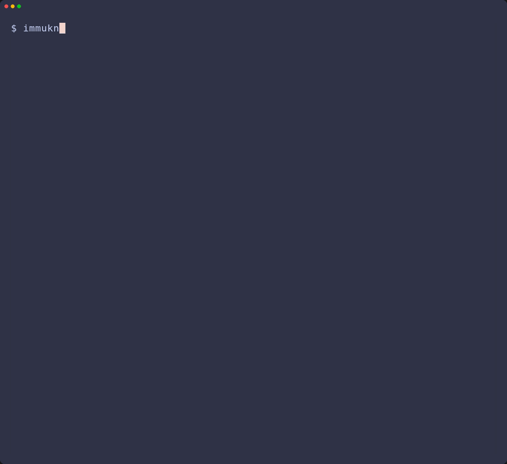

# 1,000 custom notices in about a minute

The standalone Rust pipeline created **1,000 personalized notices in about 60 seconds**: 2,000 pages, 1,000 separate password-protected copies and 10 grouped PDFs, each with a CSV listing page membership. The notices included different client information and 667 QR codes.

The Gantt chart rounds this to **60 seconds**. The rows separate composing pages and QR codes, writing PDFs, checking content and page counts, saving files, making and checking protected copies, grouping originals, and saving the report. These jobs repeat for each person. Protected copies are made alongside notice creation.

[Open the interactive Gantt chart](../assets/notice-timing.html) or its [static version](../assets/notice-timing.svg). Start, pause or move through the minute, watch the recorded output counts, and select any of the 13 jobs to see what it does. Choose Automatic, Light or Dark for the appearance. Automatic follows the documentation theme, or your system preference when opened separately. Stronger blocks show more work during that second. The chart starts paused and works without an internet connection once downloaded.

<iframe src="../../assets/notice-timing.html" title="Interactive Gantt chart: creating 1,000 personalized notices" width="100%" height="1550" loading="lazy" style="border:0;border-radius:12px"></iframe>

## What the timing includes

The whole-command measurement includes reading and preparing the input, creating and checking the notices, saving originals, making and checking protected copies, combining notices, and saving the run report. It uses one warm Typst engine, one encryption worker and four workers for combining independent groups. The application needs neither Python nor a separate Typst command.

This was fictional client data in a shared environment limited to 4 CPUs and 8 GiB RAM, with warm filesystem caches. It is a measured example, not a capacity guarantee. Your templates, page counts, fonts, settings and computer will affect the result. Your project supplies the wording and appearance; the upstream system assesses immunization status.

The interactive chart rounds the profiled workflow to 60 seconds and shows recorded activity in one-second blocks. The counters replay recorded completions rather than assuming that every notice takes the same time. Expand the chart's timing table for the measured breakdown. Encryption overlaps the main work and is not added to that table's total.

## See a real command

This short CLI demonstration uses the six fictional clients from ImmuKnow Template. It demonstrates the command and saved results; it is separate from the 1,000-client benchmark. See [getting started](getting_started.md) to run your own project.

Developers can follow the [library map](../developer_guide/architecture.md#libraries-in-the-pipeline) or the [visual maintenance notes](../developer_guide/documentation.md#maintaining-the-visuals).
